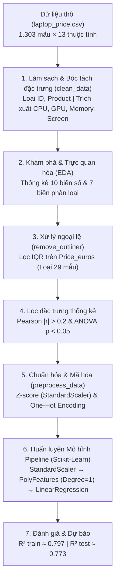

# 💻 PHÂN TÍCH CÁC YẾU TỐ CẤU HÌNH VÀ XÂY DỰNG MÔ HÌNH DỰ ĐOÁN GIÁ BÁN LAPTOP


Đồ án môn học: **Phân tích và Trực quan dữ liệu (IE313)** - Trường Đại học Công nghệ Thông tin (UIT) - ĐHQG-HCM

---

## 📌 1. Giới thiệu Đề tài & Đặt vấn đề

Thị trường máy tính xách tay (Laptop) hiện nay vô cùng phong phú và phát triển mạnh mẽ với nhiều phân khúc cấu hình, công nghệ và mức giá khác nhau. Dự án này được nghiên cứu và triển khai nhằm mục tiêu:

- **Phân tích khám phá (EDA) và kiểm định thống kê:** Xác định những yếu tố phần cứng then chốt (RAM, CPU, GPU, loại ổ cứng, kích thước màn hình, độ phân giải, thương hiệu...) có tác động mang ý nghĩa thống kê đến giá bán (`Price_euros`).
- **Xây dựng Pipeline học máy tự động hóa hoàn chỉnh:** Từ khâu Nạp dữ liệu  $\rightarrow$ Tiền xử lý & Trích xuất đặc trưng $\rightarrow$ Xử lý ngoại lệ (IQR) $\rightarrow$ Chọn lọc đặc trưng (Pearson & One-way ANOVA) $\rightarrow$ Chuẩn hóa & Mã hóa One-Hot $\rightarrow$ Huấn luyện và Đánh giá Mô hình Hồi quy Pipeline.

---

## 📁 2. Cấu trúc Dự án (Directory Structure)

```text
ie313-laptop-price-prediction/
├── data/                            # Thư mục chứa dữ liệu dạng bảng
│   ├── raw/                         # Dữ liệu thô ban đầu (laptop_price.csv - 1.303 mẫu, 13 thuộc tính)
│   └── processed/                   # Dữ liệu sạch sau tiền xử lý (clean_laptop_price.csv)
├── src/                             # Thư mục mã nguồn chính (Python Package)
│   ├── __init__.py                  # Đánh dấu Python Package
│   ├── config.py                    # Cấu hình đường dẫn, hằng số, ngưỡng thống kê và random_state
│   ├── data_loader.py               # Đọc & kiểm tra tính toàn vẹn của dữ liệu thô
│   ├── preprocessor.py              # Làm sạch, bóc tách đặc trưng, lọc IQR, One-Hot Encoding, Z-score
│   ├── eda.py                       # Thống kê mô tả, trực quan hóa Dashboard & Kiểm định ANOVA / Pearson
│   ├── model_pipeline.py            # Scikit-Learn Pipeline (StandardScaler + Poly Features + Linear Regression)
│   └── utils.py                     # Tiện ích bóc tách cấu hình CPU, GPU, RAM, Memory (SSD, HDD...)
├── tests/                           # Thư mục kiểm thử tự động (Unit & Integration Tests)
│   ├── __init__.py                  # Đánh dấu package kiểm thử
│   ├── conftest.py                  # Fixtures dữ liệu mẫu & cấu hình headless matplotlib (Agg)
│   ├── test_config.py               # Kiểm thử đường dẫn và siêu tham số cấu hình
│   ├── test_data_loader.py          # Kiểm thử nạp dữ liệu thô và xử lý ngoại lệ
│   ├── test_eda.py                  # Kiểm thử thống kê mô tả, tương quan Pearson, kiểm định ANOVA
│   ├── test_integration.py          # Kiểm thử tích hợp toàn bộ pipeline từ đầu đến cuối
│   ├── test_model_pipeline.py       # Kiểm thử huấn luyện mô hình hồi quy Scikit-Learn Pipeline
│   ├── test_preprocessor.py         # Kiểm thử làm sạch, tiền xử lý và lọc ngoại lệ
│   └── test_utils.py                # Kiểm thử các hàm regex trích xuất CPU/GPU/Ổ cứng
├── reports/                         # Báo cáo học thuật & Slide thuyết trình đồ án
│   ├── Nhom5_Bao_cao.docx           # Báo cáo Word hoàn chỉnh (chuẩn mẫu đồ án IE313)
│   ├── Nhom5_Bao_cao.pdf            # Bản xuất PDF báo cáo
│   ├── Nhom5_Slide.pdf              # Slide báo cáo thuyết trình
│   └── img/                         # Các biểu đồ xuất ra từ quá trình phân tích EDA & Huấn luyện
├── .gitignore                       # Bỏ qua môi trường ảo, cache bytecode, ruff và pytest
├── main.py                          # Điểm thực thi chính (Entry Point) chạy pipeline tự động từ CLI
├── demo.ipynb                       # Notebook trình diễn trực quan hóa
├── pyproject.toml                   # Cấu hình dự án, phụ thuộc thư viện, linter và pytest do uv quản lý
├── uv.lock                          # File khóa phiên bản thư viện chính xác của uv
├── requirements.txt                 # File xuất phụ thuộc dự phòng cho pip truyền thống
└── README.md                        # Tài liệu hướng dẫn cài đặt, quy trình kỹ thuật & sử dụng
```

---

## 🛠️ 3. Yêu cầu & Hướng dẫn Cài đặt Môi trường (`uv`)

Dự án sử dụng trình quản lý gói siêu tốc **`uv`** (viết bằng Rust) và yêu cầu **Python >= 3.12**.

### Bước 1: Clone Repository

```bash
git clone https://github.com/vanthom04/ie313-laptop-price-prediction.git
cd ie313-laptop-price-prediction
```

### Bước 2: Khởi tạo & Đồng bộ Môi trường với `uv`

```bash
# Tạo môi trường ảo
uv venv

# Đồng bộ tự động tất cả thư viện từ pyproject.toml và uv.lock
uv sync
```

_(Phương án dự phòng nếu sử dụng `pip` truyền thống: `pip install -r requirements.txt`)_

---

## 🚀 4. Hướng dẫn Chạy Chương trình & Kiểm thử

### Option 1: Chạy quy trình tự động hoàn chỉnh từ Terminal

Chạy toàn bộ quy trình từ tải dữ liệu, làm sạch, phân tích thống kê, lọc đặc trưng đến huấn luyện mô hình:

```bash
uv run python main.py
```

### Option 2: Mở Jupyter Notebook để xem trực quan biểu đồ

Notebook `demo.ipynb` gồm **23 ô** được tổ chức khoa học với đầy đủ thuyết minh Markdown học thuật, bảng số liệu và biểu đồ trực quan:

```bash
uv run jupyter lab
# Mở file demo.ipynb và chạy toàn bộ các ô (Run All)
```

### Option 3: Chạy bộ Kiểm thử Tự động Toàn diện (`pytest`)

Dự án tích hợp bộ kiểm thử gồm **40 bài test** (Unit Tests & Integration Tests) bao phủ 100% các mô-đun:

```bash
uv run pytest -v
```

### Option 4: Kiểm tra Chuẩn Mã nguồn & Linting (`ruff`)

Kiểm tra cú pháp, quy chuẩn format và loại bỏ import dư thừa:

```bash
uv run ruff check .
```

---

## ⚙️ 5. Quy trình Kỹ thuật Chi tiết (Data Pipeline Workflow)

Quy trình xử lý dữ liệu và học máy được triển khai nghiêm ngặt qua 7 bước:



### Chi tiết các bước thực hiện:

1. **Data Loading (`src/data_loader.py`):**
   - Đọc dữ liệu từ file [`data/raw/laptop_price.csv`](file:///D:/Workspace/uit/ie313-laptop-price-prediction/data/raw/laptop_price.csv).
   - Kiểm tra kích thước (1.303 dòng $\times$ 13 cột) và tính toàn vẹn kiểu dữ liệu.

2. **Data Cleaning & Feature Extraction (`src/preprocessor.py`):**
   - **Loại bỏ cột định danh:** `laptop_ID` và `Product` do không mang ý nghĩa thống kê dự báo.
   - **Chuẩn hóa dạng số:** Cắt bỏ đơn vị `"GB"` ở `Ram`, `"kg"` ở `Weight` và ép về kiểu số thực.
   - **Phòng thủ giá trị khuyết (Missing Values):** Điền `median` cho biến số và `mode` cho biến phân loại.
   - **Bóc tách đặc trưng con:**
     - `ScreenResolution` $\rightarrow$ `Touchscreen` (0/1), `Ips` (0/1), `Resolution` (ví dụ: `1920x1080`).
     - `Cpu` $\rightarrow$ `Cpu_Speed` (xung nhịp float bằng Regex `(\d+\.?\d*)\s*GHz`), `Cpu_Brand` (Intel Core i3/i5/i7, AMD...).
     - `Memory` $\rightarrow$ `SSD`, `HDD`, `Flash_Storage`, `Hybrid` (dung lượng tính theo GB).
     - `Gpu` $\rightarrow$ `Gpu_Brand` (Intel, Nvidia, AMD), `Gpu_Type` (GeForce, Quadro, Radeon...).
   - Tập dữ liệu sau bước này gồm **18 cột** (17 đặc trưng + 1 biến mục tiêu `Price_euros`).

3. **Exploratory Data Analysis - EDA (`src/eda.py`):**
   - Thống kê mô tả và trực quan hóa phân phối bằng Dashboard Histogram và Boxplot cho 10 biến số.
   - Trực quan hóa tần suất và phân phối giá theo danh mục bằng Count Plot và Boxplot cho 7 biến phân loại.

4. **Xử lý Ngoại lệ - Outlier Handling (`src/preprocessor.py`):**
   - Sử dụng khoảng tứ phân vị (IQR) trên biến mục tiêu `Price_euros`:
     $$\text{IQR} = Q_3 - Q_1, \quad \text{Upper Bound} = Q_3 + 1.5 \times \text{IQR}$$
   - Loại bỏ 29 mẫu máy ngoại lệ có giá vượt cận trên (~2.800 EUR) để tránh làm lệch đường hồi quy, đưa tập dữ liệu về **1.274 mẫu**.

5. **Lọc Đặc trưng Thống kê - Feature Selection (`src/eda.py`):**
   - **Biến số (Tương quan Pearson):** Giữ lại các biến có $|r| > 0.2$ đối với `Price_euros`:
     - `Ram` ($r = 0.71$) và `SSD` ($r = 0.65$) có tương quan thuận mạnh nhất.
     - `Cpu_Speed` ($r = 0.42$), `Touchscreen` ($r = 0.20$), `Ips` ($r = 0.24$) đạt chuẩn lọc.
     - `Inches`, `Weight`, `HDD`, `Flash_Storage`, `Hybrid` bị loại do tương quan thấp.
   - **Biến phân loại (Kiểm định One-way ANOVA):** Tất cả 7 biến phân loại (`Company`, `TypeName`, `OpSys`, `Resolution`, `Cpu_Brand`, `Gpu_Brand`, `Gpu_Type`) đều có $p\text{-value} \ll 0.05$, chứng tỏ sự khác biệt về mức giá giữa các nhóm là có ý nghĩa thống kê rất cao.

6. **Chuẩn hóa & Mã hóa - Preprocessing (`src/preprocessor.py`):**
   - Chuẩn hóa Z-score (`StandardScaler`) cho các biến số liên tục (`Ram`, `SSD`, `Cpu_Speed`).
   - Giữ nguyên giá trị nhị phân 0/1 cho `Touchscreen` và `Ips` (`ignore_col`).
   - Mã hóa One-Hot (`pd.get_dummies` với `drop_first=True`) cho 7 biến phân loại nhằm triệt tiêu hiện tượng đa cộng tuyến.
   - Dữ liệu sau bước này mở rộng thành **63 chiều đặc trưng đầu vào ($X$)** và 1 cột mục tiêu ($y$).

7. **Huấn luyện Mô hình & Đánh giá (`src/model_pipeline.py`):**
   - Xây dựng Scikit-Learn Pipeline: `StandardScaler` $\rightarrow$ `PolynomialFeatures` $\rightarrow$ `LinearRegression`.
   - Chia tập dữ liệu Train/Test theo tỷ lệ 80:20 (`test_size=0.2`, `random_state=0`).
   - Đánh giá hiệu năng:
     - **Bậc 1 (Tuyến tính):** $R^2_{\text{train}} \approx 0.7968$, $R^2_{\text{test}} \approx 0.7725$, chênh lệch chỉ $0.0244$ $\rightarrow$ **Mô hình tối ưu nhất, không bị overfitting**.
     - **Bậc 2 & Bậc 3:** $R^2_{\text{test}}$ giảm sút nghiêm trọng ($0.4730$ ở bậc 2 và $< 0$ ở bậc 3) do hiện tượng bùng nổ số chiều gây overfitting nặng.

---

## 📊 6. Bảng Biến thiên Số chiều Đặc trưng qua các Giai đoạn

| Giai đoạn xử lý                             | Số dòng | Số đặc trưng ($X$) | Cột mục tiêu ($y$) | Tổng số cột |
| :------------------------------------------ | :-----: | :----------------: | :----------------: | :---------: |
| **1. Dữ liệu thô ban đầu**                  | $1.303$ |         12         |         1          |     13      |
| **2. Sau làm sạch & trích xuất**            | $1.303$ |         17         |         1          |     18      |
| **3. Sau loại bỏ ngoại lệ (IQR)**           | $1.274$ |         17         |         1          |     18      |
| **4. Sau lọc đặc trưng (Pearson & ANOVA)**  | $1.274$ |         12         |         1          |     13      |
| **5. Đưa vào huấn luyện (One-Hot Encoded)** | $1.274$ |       **63**       |         1          |   **64**    |

---

## 👥 7. Phân công Nhiệm vụ (Team Members)

|  STT  | Họ và tên         |   MSSV   | Email                     | Vai trò & Trách nhiệm chính                                                                                                                                                                |
| :---: | :---------------- | :------: | :------------------------ | :----------------------------------------------------------------------------------------------------------------------------------------------------------------------------------------- |
| **1** | **Chu Văn Thơm**  | 25410314 | vanthom04.dev@gmail.com   | Setup project và quản lý môi trường `uv`, cấu hình `src/config.py`, `main.py`, thiết kế `demo.ipynb`, xây dựng hệ thống 40 bài tests tự động, tổng hợp Báo cáo Word và Slide thuyết trình. |
| **2** | **Trần Ngọc Tâm** | 25410300 | tranngoctam13a@gmail.com  | Tải và chuẩn bị dữ liệu thô từ Kaggle, phát triển `src/data_loader.py`, `src/preprocessor.py`, biên soạn nội dung phần Dữ liệu & Tiền xử lý trong Báo cáo/Slide.                           |
| **3** | **Hồ Thiên Phúc** | 25410284 | hothienphuc1999@gmail.com | Phát triển `src/eda.py`, `src/model_pipeline.py` (Kiểm định ANOVA, Tương quan Pearson, Scikit-Learn Pipeline), biên soạn nội dung EDA & Mô hình hóa.                                       |

---

## 🛡️ 8. Cam kết Minh bạch (Transparency Statement)

Bộ dữ liệu sử dụng trong dự án được tham khảo công khai từ nguồn uy tín: [Laptop Price Dataset (Kaggle)](https://www.kaggle.com/datasets/muhammetvarl/laptop-price). Toàn bộ mã nguồn, cấu trúc mô hình, kiểm thử tự động, sổ tay trực quan hóa và báo cáo học thuật đều do các thành viên trong Nhóm 5 tự thiết kế và thực hiện độc lập, tuân thủ nghiêm ngặt chuẩn mực liêm chính học thuật của môn học **Phân tích và Trực quan dữ liệu (IE313)**.
